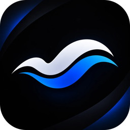

<h1 align="center">WaveStrap</h1>

A fast, lightweight Roblox launcher and customization client for Windows 10 &amp; 11.

<a href="https://github.com/Vantisstraped/WaveStrap/releases/latest"><b>⬇ Download the latest version</b></a>

---

## Install

1. Open **[Releases](https://github.com/Vantisstraped/WaveStrap/releases/latest)** and download `WaveStrap-Setup-<version>.exe`.
2. Run it. You can choose the install folder, and it adds Start Menu and desktop shortcuts.
3. WaveStrap updates itself from this page. Every update is hash-verified before it installs.

> Windows SmartScreen may warn about a new, unsigned app. Choose **More info → Run anyway**.

## What it does

- **Play Roblox** with your existing Roblox sign-in. WaveStrap never asks for your password or cookies.
- **Custom cursors:** built-in themes, or import PNG / CUR / ANI packs. Adjust size, color, outline and contrast with a live preview.
- **Mods:** sounds, crosshair and more, with one-click on/off. Original files are always backed up and restored.
- **Graphics:** Roblox's own quality and frame-rate cap, plus Roblox-allowed advanced settings.
- **Profiles:** Default, Competitive, Casual and Custom. Switch instantly.
- **Installation tools:** verify, repair and reinstall Roblox through Roblox's official installer.
- Customizations are **re-applied automatically** after Roblox updates.

## Safety

WaveStrap never injects DLLs, edits memory or touches anti-cheat. Mods may only contain image, sound and font files. It only writes client settings Roblox officially allows.

---

This repository only hosts releases. WaveStrap is not affiliated with Roblox Corporation.
